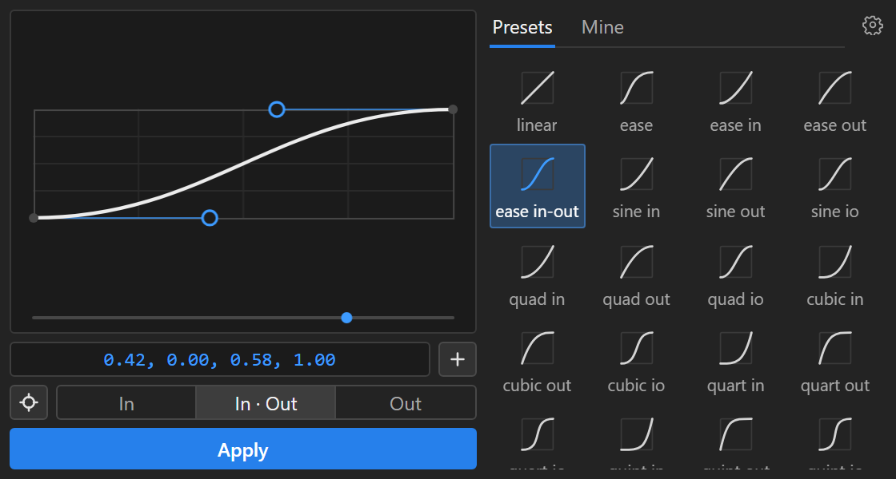
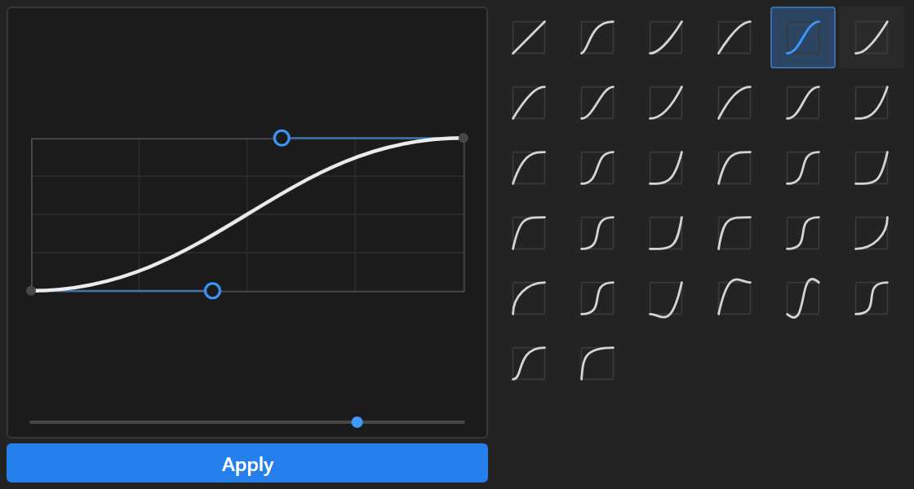
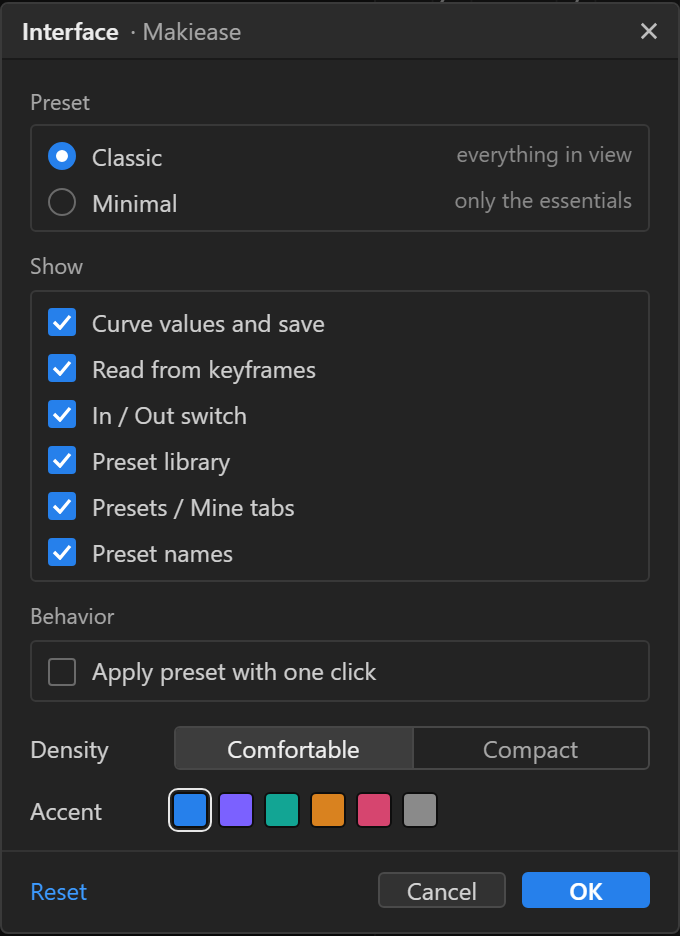

<p align="center"></p>

<p align="center">
  <a href="https://github.com/Moliiknis/Makiease/releases/latest"></a>
  <a href="https://github.com/Moliiknis/Makiease/releases"></a>
  
  
  <a href="LICENSE.md"></a>
</p>

<p align="center"><b>Keyframe easing, one click away</b><br><sub>Плавность ключей в один клик</sub></p>

<p align="center"><b>English</b> · <a href="#русский">Русский</a></p>

<p align="center"><a href="https://github.com/Moliiknis/Makiease/releases/latest"><b>⬇ Download Makiease-1.2.0-Setup.exe</b></a></p>

## English

Draw a Bezier curve or pick a preset and apply it to the selected keyframes. The panel shows the motion live.

Similar to **Flow (aescripts)**. Written from scratch: not affiliated with its authors and contains none of their code.

<table>
<tr><td width="33%" valign="top"><b>Curve editor</b><br><sub>Drag the handles, see the motion preview live.</sub></td><td width="33%" valign="top"><b>32 presets</b><br><sub>From gentle eases to overshoots, plus your own.</sub></td><td width="33%" valign="top"><b>Read from keys</b><br><sub>Grab the curve from existing keyframes.</sub></td></tr>
<tr><td width="33%" valign="top"><b>Exact values</b><br><sub>Type x1, y1, x2, y2 by hand.</sub></td><td width="33%" valign="top"><b>In, Out or both</b><br><sub>Apply to either side of the keyframes.</sub></td><td width="33%" valign="top"><b>Two interfaces</b><br><sub>Classic, or Minimal with one-click presets.</sub></td></tr>
</table>

### Two interfaces

Choose how much interface you see. Two presets come built in, **Classic** (everything in view) and **Minimal** (only the essentials), and you can build your own: which parts to show, density and accent color.
- **Makiease:** click ⚙ in the corner or use the panel menu (≡). The setup is saved for that panel.

<table>
<tr><td align="center"><b>Classic</b></td><td align="center"><b>Minimal</b></td></tr>
<tr><td></td><td></td></tr>
</table>

<p align="center"><br><sub>⚙ Interface settings: presets, parts to show, density, accent</sub></p>

### Install

1. Download **`Makiease-1.2.0-Setup.exe`** from [Releases](https://github.com/Moliiknis/Makiease/releases/latest).
2. Close After Effects and run the installer. No administrator rights needed.
3. Start After Effects and open **Window › Extensions › Makiease**.

> **SmartScreen?** The installer is not code-signed yet. Click *More info* → *Run anyway*.

<sub>After Effects 2021 or newer · Uninstall from *Settings → Apps → Makiease for After Effects*</sub>

<details>
<summary><b>Build from source</b></summary>

Nothing to compile: the panel is plain HTML and JavaScript.

```powershell
.\build-installer.ps1   # builds the plug-in and release\Makiease-1.2.0-Setup.exe
```

For development, `install.ps1` links the panel to the source folder instead of installing a copy.

</details>

### The Makimchi set

| Plug-in | What it does |
|---|---|
| [Makiglow](https://github.com/Moliiknis/Makiglow) | Soft, natural glow for After Effects |
| [Makimood](https://github.com/Moliiknis/Makimood) | Cinematic color grading with a live looks window |
| [Makiblur](https://github.com/Moliiknis/Makiblur) | Motion blur from the footage's own motion |
| [Makitor](https://github.com/Moliiknis/Makitor) | Smooth slow motion and speed ramps on the timeline |
| **Makiease** | Keyframe easing, one click away |
| [Makifind](https://github.com/Moliiknis/Makifind) | Find and apply any effect in two keystrokes |

### License

[PolyForm Noncommercial 1.0.0](LICENSE.md): free for personal and any noncommercial use; you may change it and share it. Commercial use (selling it, paid client work, use in a company for profit) is not allowed.

<br>

---

## Русский

Рисуешь кривую Безье или берёшь пресет и применяешь к выделенным ключам. Панель сразу показывает движение.

Аналог **Flow (aescripts)**. Написан с нуля: не связан с авторами оригинала и не содержит их кода.

<table>
<tr><td width="33%" valign="top"><b>Редактор кривой</b><br><sub>Тянешь ручки и сразу видишь движение.</sub></td><td width="33%" valign="top"><b>32 пресета</b><br><sub>От мягких до пружинящих, плюс свои.</sub></td><td width="33%" valign="top"><b>С ключей</b><br><sub>Забирает кривую с готовых ключей.</sub></td></tr>
<tr><td width="33%" valign="top"><b>Точные значения</b><br><sub>x1, y1, x2, y2 можно вписать руками.</sub></td><td width="33%" valign="top"><b>In, Out или обе</b><br><sub>Применяет к любой стороне ключей.</sub></td><td width="33%" valign="top"><b>Два интерфейса</b><br><sub>Classic или Minimal с пресетами в один клик.</sub></td></tr>
</table>

### Два интерфейса

Можно выбрать, сколько интерфейса видно. Есть два готовых пресета: **Classic** (всё на виду) и **Minimal** (только главное). Можно и собрать свой вариант: какие части показывать, плотность и цвет акцента.
- **В Makiease** нужно нажать ⚙ в углу или выбрать пункт в меню панели (≡). Настройка сохраняется для этой панели.

### Установка

1. Нужно скачать **`Makiease-1.2.0-Setup.exe`** со страницы [Releases](https://github.com/Moliiknis/Makiease/releases/latest).
2. Нужно закрыть After Effects и запустить установщик. Права администратора не нужны.
3. Нужно открыть After Effects: **Окно › Расширения › Makiease**.

> **SmartScreen?** Установщик пока не подписан сертификатом. Нужно нажать *Подробнее* → *Выполнить в любом случае*.

<sub>After Effects 2021 и новее · Удаление: *Параметры → Приложения → Makiease for After Effects*</sub>

<details>
<summary><b>Сборка из исходников</b></summary>

Компилировать нечего: панель на обычных HTML и JavaScript.

```powershell
.\build-installer.ps1   # собирает плагин и release\Makiease-1.2.0-Setup.exe
```

Для разработки `install.ps1` подключает панель ссылкой на исходники вместо копии.

</details>

### Набор Makimchi

| Плагин | Что делает |
|---|---|
| [Makiglow](https://github.com/Moliiknis/Makiglow) | Мягкое естественное свечение для After Effects |
| [Makimood](https://github.com/Moliiknis/Makimood) | Кинематографичная цветокоррекция с живым окном луков |
| [Makiblur](https://github.com/Moliiknis/Makiblur) | Motion blur из собственного движения футажа |
| [Makitor](https://github.com/Moliiknis/Makitor) | Плавный слоумо и рампы скорости прямо на таймлайне |
| **Makiease** | Плавность ключей в один клик |
| [Makifind](https://github.com/Moliiknis/Makifind) | Любой эффект за два нажатия |

### Лицензия

[PolyForm Noncommercial 1.0.0](LICENSE.md): бесплатно для личного и любого некоммерческого использования, можно изменять и делиться. Коммерческое использование (продажа, платные заказы, использование в компании ради прибыли) не разрешено.

<p align="center"><sub>Made with care · <b>Makimchi</b></sub></p>
